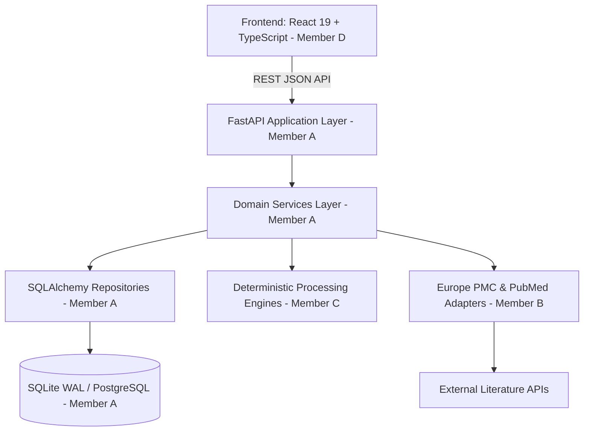
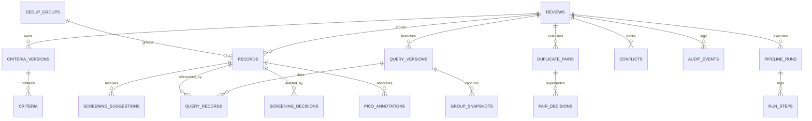

# EvidenceFlow

> **An auditable, deterministic systematic literature review platform with an evolutionary query-change loop.**

EvidenceFlow structures the complete systematic review synthesis pipeline:
$$\text{Review Protocol} \longrightarrow \text{Query Trees} \longrightarrow \text{Multi-Source Ingestion} \longrightarrow \text{Graph Deduplication} \longrightarrow \text{Screening (I/E/M)} \longrightarrow \text{PICO Extraction} \longrightarrow \text{Consensus Resolution} \longrightarrow \text{RFC 4180 CSV Export}$$

EvidenceFlow solves the fundamental challenge of systematic reviews: **How to iterate on literature search queries without losing human reviewer screening decisions, duplicate pair resolutions, or audit history.**

---

## 1. Non-Negotiable Architectural Invariants

1. **Zero Data Deletion**: Records, decisions, suggestions, pairs, and audit rows are **never deleted**. De-selected or reverted records are soft-hidden via state (`is_hidden = True`).
2. **Machine vs. Human Sovereignty**: Machine predictions (`screening_suggestions`, `duplicate_pairs`) and sovereign human verdicts (`screening_decisions`, `pair_decisions`) live in separate tables. Machine code **never** writes or mutates human tables.
3. **Mandatory Exclusion Reasons**: Every exclusion verdict (`decision == 'exclude'`) strictly requires an explicit reason (either a linked `criterion_id` or non-empty `reason_text`). Enforced simultaneously at schema check constraint, API, and Pydantic validator levels (HTTP 422).
4. **Zero Auto-Resolved Conflicts**: Opposing human verdicts (`include` vs `exclude`) or transitive duplicate bypasses are flagged as open `Conflict` items. Only human consensus panels can resolve conflicts.
5. **Deterministic Idempotency**: Repeated ingestion runs, pair scorings, and clustering operations never duplicate records, pairs, or audit events.
6. **Zero Secrets in Git**: All configuration is managed via environment variables (`.env`).

---

## 2. System Architecture & Algorithms (DSA)



### High-Efficiency Algorithmic Foundations
- **Graph Connected-Components with Rejection Guards (Disjoint-Set Union / Union-Find)**: Merges candidate duplicate pairs into canonical `DedupGroup` clusters in near $O(V + E)$ time while strictly enforcing negative constraints (Scenario D cannot-links).
- **Breadth-First Search (BFS) Transitive Conflict Paths**: When an edge violates a human pair rejection, the system executes BFS to reconstruct and display the exact explanatory path (`A -> C -> B`) in $O(V + E)$.
- **Deterministic Canonical Representative Election**: Within each cluster, the primary study is chosen by:
  $$\text{Presence of DOI} > \text{Presence of PMID} > \text{Longest Abstract} > \text{Earliest Publication Year}$$
- **Zero-API Rollback (Scenario E)**: Workspace state is restored directly from immutable `GroupSnapshot` rows in $O(1)$ dictionary lookups without making external HTTP requests.
- **Elimination of N+1 Queries**: Relational traversals use eager `joinedload` on decisions, suggestions, and PICO spans.

---

## 3. Relational Schema Catalog (18 Tables)



1. **`reviews`**: Project metadata, research question, PICO definition, and active criteria.
2. **`criteria_versions`**: Immutable criteria version trees.
3. **`criteria`**: Inclusion and exclusion rules with field targets and detector rules.
4. **`query_versions`**: Search tree with parent lineage, expressions, date ranges, and hit counts.
5. **`query_records`**: Junction table mapping records to the query version that retrieved them.
6. **`records`**: Normalized bibliographic citations. Idempotency key: `(review_id, source, source_record_id)`.
7. **`dedup_groups`**: Clusters of duplicate records referencing the canonical study.
8. **`duplicate_pairs`**: Pairwise similarity comparisons with confidence tiers.
9. **`pair_decisions`**: Reviewer duplicate verdicts (`confirm` / `reject`).
10. **`group_snapshots`**: Immutable workspace assignments captured at query run completion.
11. **`screening_suggestions`**: Heuristic recommendations with evidence snippets and content hashes.
12. **`screening_decisions`**: Append-only human screening verdicts with schema check constraints.
13. **`pico_annotations`**: Clinical entity spans ($P, I, C, O$) with offsets and confidence scores.
14. **`conflicts`**: Opposing verdicts and transitive bypasses flagged for consensus resolution.
15. **`audit_events`**: Append-only immutable system ledger tracking all actions.
16. **`pipeline_runs`**: Execution tracker for asynchronous processing pipelines.
17. **`run_steps`**: Granular execution logs per pipeline stage.

---

## 4. The Literature Search Evolution Loop

| Scenario | Trigger / User Action | System Behavior & Invariant Guarantees |
| :--- | :--- | :--- |
| **Scenario A** | Initial search formulation | Query version created in `draft`, frozen into `previewed`, approved, and imported. Groups formed and snapshotted. |
| **Scenario B** | Query broadening ($\text{Query } V_2$) | New records appended idempotently; retained records keep existing group assignments and screening decisions. |
| **Scenario C** | Query narrowing ($\text{Query } V_3$) | Excluded search records are soft-hidden (`is_hidden = True`); zero rows deleted. |
| **Scenario D** | Human pair rejection ($X \neq Y$) | Negative cannot-link prevents transitive merging. Transitive bypass flags open conflict with BFS explanation path. |
| **Scenario E** | Exact Revert ($V_2 \rightarrow V_1$) | Restores workspace from `GroupSnapshot` with **0 external API calls**. Historical decisions remain 100% intact. |
| **Scenario F** | Criteria Evolution Loop | New immutable `CriteriaVersion` created. Machine suggestions refreshed while human decisions remain sovereign. |

---

## 5. API Reference Summary

### Reviews & Criteria
- `POST /api/reviews` — Create review with PICO framing and initial criteria.
- `GET /api/reviews/{id}` — Fetch review protocol and active criteria.
- `POST /api/reviews/{id}/criteria` — Append new immutable criteria version.

### Query Evolution & Pipeline
- `POST /api/reviews/{id}/queries` — Create child query in version tree.
- `GET /api/reviews/{id}/queries` — List query version hierarchy.
- `POST /api/queries/{id}/preview` — Estimate hits and freeze query spec.
- `POST /api/queries/{id}/import` — Trigger ingestion, dedup, and snapshot capture.
- `GET /api/queries/{id}/diff?against={parent_id}` — Mathematical set difference.
- `POST /api/queries/{id}/revert` — Scenario E zero-API rollback.

### Records & Deduplication
- `GET /api/reviews/{id}/records` — Filtered, search-enabled pagination (`representatives_only=true`, `q=...`).
- `GET /api/records/{id}` — Full study details with cluster siblings, decision lineage, and PICO spans.
- `GET /api/reviews/{id}/duplicate-pairs` — List candidate duplicate pairs by tier.
- `POST /api/reviews/{id}/pair-decisions` — Record human duplicate verdict (`confirm` / `reject`).

### Screening & Consensus
- `POST /api/records/{id}/screening` — Human screening verdict (enforces mandatory reason on exclude; propagates to cluster; detects reviewer conflicts).
- `PATCH /api/records/{id}/pico` — Curate clinical entity spans (`confirm`, `correct`, `reject`).
- `GET /api/reviews/{id}/conflicts` — List open reviewer conflicts.
- `POST /api/conflicts/{id}/resolve` — Human consensus resolution applied to cluster.

### Export & Audit
- `GET /api/reviews/{id}/export.csv` — RFC 4180 CSV export of included studies (quarantines conflicting clusters with `X-Conflict-Warning`).
- `GET /api/reviews/{id}/audit` — Paginated append-only immutable audit trail.

---

## 6. Getting Started & Testing

### Installation
```bash
# Clone and configure environment
git clone https://github.com/SHRINIVAS-BHONG/evidenceflow.git
cd evidenceflow
cp .env.example .env

# Set up backend virtual environment
python -m venv .venv
.\.venv\Scripts\Activate.ps1
pip install -e "./backend[dev]"

# Run database migrations to head
python -m alembic -c backend/alembic.ini upgrade head
```

### Running the API Server
```bash
python -m uvicorn app.main:app --reload --port 8000
```
Interactive OpenAPI documentation is available at [http://127.0.0.1:8000/docs](http://127.0.0.1:8000/docs).

### Test Suite Execution
```bash
# Run full automated test suite (223 passing tests)
python -m pytest backend/tests/ -v

# Run code standards & formatting checks
python -m ruff check backend/
python -m ruff format --check backend/
```
