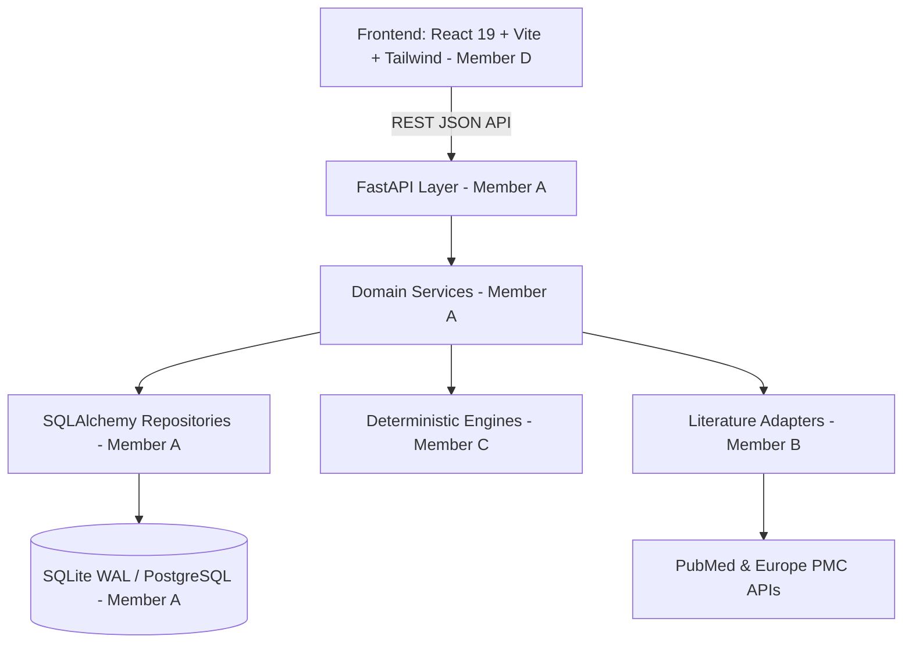

# EvidenceFlow — System Architecture & Technical Design

## 1. High-Level Architecture

EvidenceFlow is built on a modular, decoupled architecture cleanly dividing responsibilities across Team Members (A, B, C, D) with strict contract interfaces:



---

## 2. Layered Backend Design (Member A)

### Layer 1: Core (`backend/app/core`)
- `config.py`: Environment configuration via Pydantic Settings.
- `database.py`: Thread-safe database engine, SQLite WAL pragmas (`PRAGMA journal_mode=WAL`, `PRAGMA foreign_keys=ON`), session lifecycle.
- `errors.py`: Hierarchical domain errors (`NotFoundError`, `ConflictError`, `ValidationError`) mapped to standardized JSON envelope payloads:
  ```json
  {
    "error": {
      "code": "STRING_ENUM",
      "message": "Human readable explanation",
      "details": {}
    }
  }
  ```

### Layer 2: Models (`backend/app/models`)
- 18 declarative SQLAlchemy models mapping to normalized relational tables.
- Guarantees zero hard deletion, append-only superseding for screening decisions, and composite idempotency constraints.

### Layer 3: Repositories (`backend/app/repositories`)
- Encapsulates database read/write queries:
  - `ReviewRepository`: Review CRUD, criteria version trees.
  - `QueryRepository`: Query lineage, preview persistence, mathematical set difference.
  - `PipelineRunRepository`: Step progress tracking.

### Layer 4: Services (`backend/app/services`)
- `QueryService`: Query previewing, branch trees, set diffs, and Scenario E Revert.
- `DeduplicationDBService`: Transitive graph clustering with rejection constraints (`group_with_rejections`), BFS shortest path conflict explanations, canonical study election.
- `RecordService`: Index-backed listing, text search, pagination, and eager relationship loading (`joinedload`).
- `DecisionService`: Human verdict processing, cluster-wide propagation, and conflict detection.
- `PicoAnnotationService`: Batch clinical span curation (`confirm`, `correct`, `reject`).
- `ConflictService`: Human consensus resolution engine.
- `ExportService`: RFC 4180 CSV generation with active conflict quarantine.
- `AuditService`: Append-only immutable audit logging.

### Layer 5: API Endpoints (`backend/app/api`)
- FastAPI routers registered with prefix `/api`:
  - `/reviews`, `/queries`, `/runs`, `/dedup`, `/records`, `/screening`, `/pico`, `/conflicts`, `/export`.

---

## 3. Data Structures & Algorithms (DSA) Optimizations

1. **Graph Connected Components with Rejection Constraints**:
   - Uses Disjoint Set Union (Union-Find) with path compression and rank optimization to cluster duplicate studies in near $O(V + E)$ time.
   - Enforces human negative constraints ("cannot-link" rejected pairs): if merging two components violates an existing rejection, the edge is blocked and queued for reviewer conflict review.

2. **Breadth-First Search (BFS) Shortest Transitive Conflict Path**:
   - When an edge is blocked by a transitive merge, the system runs BFS over the graph to reconstruct and log the exact explanatory path (`A -> C -> B`) in $O(V + E)$.

3. **Elimination of N+1 Queries**:
   - Record listings, CSV exports, and detailed study views utilize eager `joinedload` on `Record.decisions`, `Record.suggestions`, and `Record.pico_annotations`.

4. **Zero-API Revert (Scenario E)**:
   - Evaluates `GroupSnapshot` rows in $O(1)$ dictionary lookups to reset workspace state without external network I/O.
