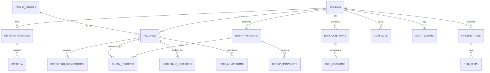

# EvidenceFlow — Database Design Specification

## 1. Relational Architecture & Engine
- **Supported Databases**: SQLite (Development, WAL mode enabled, foreign keys enforced) and PostgreSQL (Production).
- **ORM / Migrations**: SQLAlchemy 2.0 with Alembic versioning.
- **Timestamp Standard**: UTC ISO-8601 timestamps (`utc_now()`).
- **Primary Keys**: 36-character UUID string primary keys generated deterministically or via `uuid4()`.

---

## 2. Table Catalog (18 Tables)

### Table 1: `reviews`
- Core project entity representing a systematic review protocol.
- Columns: `id`, `title`, `question`, `pico` (JSON), `status`, `created_at`, `updated_at`.

### Table 2: `criteria_versions`
- Append-only criteria evolution lineage.
- Columns: `id`, `review_id`, `version_number`, `created_at`.
- Unique constraint: `(review_id, version_number)`.

### Table 3: `criteria`
- Atomic eligibility criteria rules.
- Columns: `id`, `criteria_version_id`, `type` (`inclusion` | `exclusion`), `label`, `description`, `field_target`, `detector_rule`.

### Table 4: `query_versions`
- Evolutionary search tree nodes.
- Columns: `id`, `review_id`, `parent_id`, `version_number`, `label`, `expression`, `source`, `synonyms`, `title_abstract_only`, `date_from`, `date_to`, `language`, `status` (`draft` | `previewed` | `approved`), `hit_count`, `imported_count`, `created_at`, `frozen_at`.

### Table 5: `query_records`
- Many-to-many junction table between query versions and bibliographic records.
- Columns: `query_version_id`, `record_id`.
- Composite Primary Key: `(query_version_id, record_id)`.

### Table 6: `records`
- Canonical normalized bibliographic citations. **Never deleted**.
- Columns: `id`, `review_id`, `source`, `source_record_id`, `doi`, `pmid`, `title`, `authors` (JSON), `journal`, `publication_year`, `abstract`, `mesh_headings` (JSON), `publication_types` (JSON), `language`, `group_id`, `is_representative`, `is_hidden`, `raw_payload` (JSON), `created_at`.
- Unique constraint: `(review_id, source, source_record_id)` (Non-negotiable idempotency key).
- Composite index: `("title", "publication_year")`.

### Table 7: `dedup_groups`
- Cluster entity representing merged duplicate studies.
- Columns: `id`, `review_id`, `canonical_record_id`, `created_at`.

### Table 8: `duplicate_pairs`
- Pairwise similarity evaluation between records.
- Columns: `id`, `review_id`, `record_a_id`, `record_b_id`, `similarity_score`, `tier` (`tier_1_exact`, `tier_2_high_confidence`, `tier_3_review_needed`), `match_reasons` (JSON), `status` (`pending`, `confirmed`, `rejected`), `created_at`.
- Unique constraint: `(review_id, record_a_id, record_b_id)`.

### Table 9: `pair_decisions`
- Human reviewer duplicate decisions.
- Columns: `id`, `duplicate_pair_id`, `decision` (`confirm`, `reject`), `reviewer_name`, `note`, `created_at`.

### Table 10: `group_snapshots`
- Immutable workspace snapshot captured at query import completion.
- Columns: `id`, `query_version_id`, `record_id`, `group_id`, `is_representative` (`true` | `false`), `created_at`.
- Unique constraint: `(query_version_id, record_id)`.

### Table 11: `screening_suggestions`
- Machine heuristic recommendations.
- Columns: `id`, `record_id`, `criteria_version_id`, `suggested_decision` (`include`, `exclude`, `maybe`), `confidence`, `matched_criterion_id`, `matched_criterion_label`, `evidence_snippets` (JSON), `content_hash`, `algo_version`, `created_at`.
- Unique constraint: `(record_id, criteria_version_id, content_hash, algo_version)`.

### Table 12: `screening_decisions`
- Append-only human screening verdicts.
- Columns: `id`, `record_id`, `group_id`, `decision` (`include`, `exclude`, `maybe`), `criterion_id`, `reason_text`, `reviewer_name`, `origin` (`human`, `inherited`, `conflict_resolution`), `note`, `superseded_by_id`, `created_at`.
- **Check Constraint**: `(decision != 'exclude') OR (criterion_id IS NOT NULL OR (reason_text IS NOT NULL AND length(trim(reason_text)) > 0))`.
- Index: `("record_id", "superseded_by_id")`.

### Table 13: `pico_annotations`
- Extracted clinical entity spans.
- Columns: `id`, `record_id`, `element` (`P`, `I`, `C`, `O`), `text`, `start_index`, `end_index`, `confidence`, `origin` (`machine`, `human`), `is_confirmed`, `created_at`.

### Table 14: `conflicts`
- Reviewer contradictions and graph transitive bypasses.
- Columns: `id`, `review_id`, `group_id`, `reason` (`include_vs_exclude`, `pair_override_bypassed`), `status` (`open`, `resolved`), `open_fingerprint` (Unique), `created_at`, `resolved_at`, `resolved_by`, `resolution_note`.

### Table 15: `audit_events`
- Append-only immutable system ledger.
- Columns: `id`, `review_id`, `actor`, `event_type`, `target_type`, `target_id`, `timestamp`, `before_state` (JSON), `after_state` (JSON), `note`.
- Index: `("review_id", "timestamp")`.

### Table 16: `pipeline_runs`
- Execution tracker for asynchronous background jobs.
- Columns: `id`, `review_id`, `query_version_id`, `run_type`, `status`, `progress_percent`, `current_step`, `error_message`, `started_at`, `completed_at`.

### Table 17: `run_steps`
- Granular step logs for a pipeline execution.
- Columns: `id`, `run_id`, `step_order`, `name`, `status`, `started_at`, `completed_at`, `message`.
