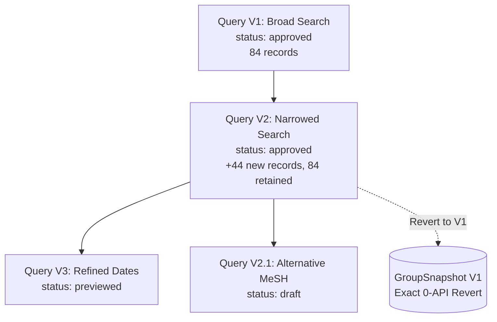

> **Design status:** This is the target loop specification. Exact revert, active workspace selection, group-decision reconciliation, and the complete processing runner are not yet implemented. See `INTEGRATION_ANALYSIS.md` for the current backend behavior.

# EvidenceFlow — Query-Change Loop Specification (LOOP_DESIGN.md)

## 1. Executive Summary & Core Principle
In systematic reviews, literature searches evolve iteratively. A reviewer frequently discovers that a query is either too broad (excessive noise) or too narrow (missing landmark studies). EvidenceFlow solves the fundamental challenge of systematic reviews: **How to evolve literature search queries without losing human reviewer screening decisions, duplicate resolutions, or audit history.**

The central invariant: **Human decisions are sovereign and append-only.** Machine pipeline reruns never modify or erase human screening verdicts, duplicate pair decisions, or PICO annotations.

---

## 2. Query Version State Machine & Lineage Tree

Each query formulation is an explicit node in a directed version tree:

### Lifecycle States:
1. **`draft`**: Query expression being formulated. Mutable. Not executed against external APIs.
2. **`previewed`**: Executed against source adapter for hit counts and sample records. **Frozen on preview**: `expression`, `source`, `synonyms`, and filters become permanently immutable (`frozen_at` timestamp recorded).
3. **`approved`**: Reviewer confirms import. Background `PipelineRun` created. Records fetched, deduplicated, screened by heuristics, and PICO entities extracted.
4. **`superseded`**: A newer query version in the lineage has been approved. Historical query remains readable.
5. **`reverted`**: Workspace rolled back to an earlier query version state using stored snapshots.

---

## 3. Mathematical Set Difference & Overlap Engine

When Query $V_2$ evolves from Query $V_1$, the pipeline computes exact set relationships:

$$\text{Records}(V_1) = S_1, \quad \text{Records}(V_2) = S_2$$

$$\text{Newly Introduced Records} = S_2 \setminus S_1$$
$$\text{Retained Overlap} = S_2 \cap S_1$$
$$\text{Dropped Records} = S_1 \setminus S_2$$

### Rules for Record Lineage:
- **Never Hard Delete**: Dropped records ($S_1 \setminus S_2$) are **never deleted** from the `records` table. They remain persisted with full provenance. They are simply not associated with the active working set of $V_2$.
- **Decision Preservation**: For all records in the retained overlap ($S_2 \cap S_1$), any existing human screening decision (`ScreeningDecision`) remains active and attached to the record.
- **Idempotent Record Ingestion**: Records are identified uniquely by $(review\_id, source, source\_record\_id)$. Re-fetching a record in $V_2$ that existed in $V_1$ produces **0 duplicate records** and 0 duplicate audit rows.

---

## 4. The 6 Authoritative Loop Scenarios

### Scenario A: Clean Expansion ($V_2$ Introduces Only New Records)
- **Input**: $V_1$ had 84 records (60 screened: 40 Included, 20 Excluded). $V_2$ adds 44 new records and retains all 84.
- **Behavior**:
  - Exactly 44 new records created.
  - 84 retained records keep their existing `dedup_group` assignments and screening decisions.
  - Diff endpoint returns: `new_records_count: 44`, `retained_records_count: 84`, `already_screened_retained_count: 60`, `potential_conflicts_count: 0`.

### Scenario B: Excluded Record Re-Appears in $V_2$
- **Input**: Record $R_{42}$ was screened and **Excluded** in $V_1$ with reason `"Non-human animal study"`. $V_2$ search strategy also retrieves $R_{42}$.
- **Behavior**:
  - Record $R_{42}$ is recognized by $(review\_id, source, source\_record\_id)$.
  - No new record row is inserted.
  - Existing `ScreeningDecision` (Excluded, Reason: `"Non-human animal study"`) remains active and untouched.
  - Reviewer UI displays record as already screened with a badge: `"Preserved from V1"`.

### Scenario C: Group Merge Contradiction (Include vs. Exclude Conflict)
- **Input**: In $V_1$, Record $A$ was screened **Included** (in DedupGroup 1) and Record $B$ was screened **Excluded** (in DedupGroup 2). In $V_2$, a newly fetched Record $C$ connects $A$ and $B$ into a single merged cluster.
- **Behavior**:
  - The deduplication graph algorithm merges groups 1 and 2.
  - The conflict engine detects conflicting decisions within the merged cluster (`Include` on $A$, `Exclude` on $B$).
  - **Non-Negotiable Rule**: Conflicts are **never resolved automatically**.
  - A `Conflict` record is created with `reason='include_vs_exclude'`, `status='open'`, and idempotency key `open_fingerprint="{review_id}:{group_id}:include_vs_exclude"`.
  - The cluster is **quarantined from CSV export** until resolved by a human reviewer.
  - Resolving the conflict updates all cluster members with the consensus decision and closes the conflict.

### Scenario D: Pair Override Bypass Guard
- **Input**: Reviewer manually rejected a duplicate pair between Record $X$ and Record $Y$ (`PairDecision(decision='reject')`). In $V_2$, candidate duplicate pairs are re-evaluated, or a third record $Z$ connects $X$ and $Y$ transitively.
- **Behavior**:
  - The deduplication clustering algorithm checks `pair_decisions` before forming transitive components.
  - The system flags an alert / conflict `reason='pair_override_bypassed'`.
  - The human rejection is respected: $X$ and $Y$ remain separated unless explicitly unblocked by the reviewer.

### Scenario E: Exact, Zero-API Revert
- **Input**: The reviewer determines that Query $V_2$ brought in excessive irrelevant noise and wants to rollback to $V_1$.
- **Behavior**:
  - At the completion of each query run, an immutable `GroupSnapshot` captures all `(query_version_id, record_id, group_id, is_representative)` rows.
  - On `POST /api/queries/{v1_id}/revert`:
    - The active workspace is restored directly from `GroupSnapshot` where `query_version_id == v1_id`.
    - Exactly **0 external API calls** are made to PubMed or Europe PMC.
    - Historical screening decisions made during $V_1$ remain 100% intact.

### Scenario F: Criteria Evolution Loop
- **Input**: Reviewer updates eligibility criteria (e.g., adding an exclusion for `"Pediatric populations"`).
- **Behavior**:
  - `POST /api/reviews/{id}/criteria` creates a new immutable `CriteriaVersion`.
  - Machine heuristics engine (`ScreeningSuggestion`) recomputes suggestions for all unscreened records.
  - **Human decisions are NEVER mutated**: Any record with an existing human `ScreeningDecision` is unchanged.
  - Machine suggestions live in `screening_suggestions` with idempotency hashes `uq_suggestion_idempotency`.

---

## 5. Ledger & Audit Guarantees
- Every human action (screening decision, duplicate confirmation, criteria update) appends an `AuditEvent` with `before_state` and `after_state`.
- No-op actions generate zero audit events.
- Audit records and pipeline runs are immutable and append-only.
